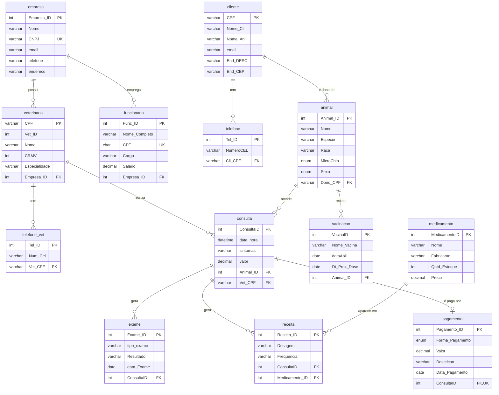

# Zoolife — Banco de dados de clínica veterinária

Modelagem e implementação, em MariaDB, do banco de dados de uma rede de clínicas veterinárias com matriz e filiais. O banco `clinica` tem 12 tabelas e cobre clientes e seus animais, veterinários, funcionários, consultas, exames, receitas, estoque de medicamentos, vacinação e pagamentos.

## Sobre o projeto

Projeto acadêmico desenvolvido em grupo na disciplina de Modelagem e Implementação de Banco de Dados com SQL (UVA). Minha contribuição: o minimundo, o dicionário de dados e os conceitos do projeto, o apoio no cadastramento dos dados e na finalização no MariaDB, e a organização e publicação deste repositório.

## Tecnologias

- **MariaDB** (scripts testados no MariaDB 13.0; os comandos Docker abaixo usam a imagem `mariadb:11.4`)
- **SQL**: DDL (`CREATE TABLE`, chaves primárias e estrangeiras, `UNIQUE`, `ENUM`) e DML (`INSERT`, `SELECT`, `UPDATE`, `DELETE`)
- **Docker**, opcional, para subir o banco sem instalar nada

## Estrutura do repositório

```
zoolife-banco-de-dados/
├── README.md
├── sql/
│   ├── 01_schema.sql          # cria o banco `clinica` e as 12 tabelas
│   ├── 02_dados_exemplo.sql   # 10 registros fictícios por tabela
│   └── 03_consultas.sql       # SELECT, JOIN, agregações, UPDATE e DELETE
└── docs/
    ├── minimundo.md           # descrição do negócio e regras
    ├── dicionario-de-dados.md # tabelas, campos, tipos e restrições
    └── conceitos.md           # dicionário de dados, minimundo e DER explicados
```

## Modelo de dados



A consulta é o centro do atendimento: liga um animal a um veterinário e dela saem exames, receitas e o pagamento. Cada veterinário e cada funcionário pertencem a uma filial (`empresa`).

## Tabelas

| Tabela | O que guarda |
|---|---|
| `empresa` | Matriz e filiais da rede (CNPJ único) |
| `cliente` | Tutores dos animais, identificados pelo CPF |
| `telefone` | Celulares dos clientes (1:N) |
| `veterinario` | Veterinários, com CRMV, especialidade e filial obrigatória |
| `telefone_vet` | Celulares dos veterinários (1:N) |
| `funcionario` | Equipe de apoio de cada filial |
| `animal` | Pacientes, sempre vinculados a um dono |
| `vacinacao` | Vacinas aplicadas e data da próxima dose |
| `consulta` | Atendimentos: animal, veterinário, sintomas e valor |
| `exame` | Exames pedidos em uma consulta |
| `medicamento` | Estoque de medicamentos |
| `receita` | Prescrições: consulta + medicamento + dosagem |
| `pagamento` | Pagamento de uma consulta (no máximo um por consulta) |

Detalhes de cada campo estão no [dicionário de dados](docs/dicionario-de-dados.md), e as regras de negócio no [minimundo](docs/minimundo.md).

## Como rodar

### Com Docker

Suba um MariaDB:

```bash
docker run -d --name zoolife-db -e MARIADB_ROOT_PASSWORD=zoolife -p 3306:3306 mariadb:11.4
```

Espere alguns segundos para o banco iniciar e rode os scripts em ordem.

No Linux/macOS (bash):

```bash
for f in sql/01_schema.sql sql/02_dados_exemplo.sql; do docker exec -i zoolife-db mariadb -uroot -pzoolife < "$f"; done
```

No Windows (PowerShell):

```powershell
Get-Content sql/01_schema.sql, sql/02_dados_exemplo.sql -Encoding UTF8 | docker exec -i zoolife-db mariadb -uroot -pzoolife --default-character-set=utf8mb4
```

Para abrir o console e testar as consultas:

```bash
docker exec -it zoolife-db mariadb -uroot -pzoolife clinica
```

### Com o MariaDB instalado na máquina

```bash
mariadb -u root -p --default-character-set=utf8mb4
```

E dentro do console:

```sql
SOURCE sql/01_schema.sql;
SOURCE sql/02_dados_exemplo.sql;
SOURCE sql/03_consultas.sql;
```

> `01_schema.sql` apaga e recria o banco `clinica`. `03_consultas.sql` termina com um `UPDATE` e um `DELETE`; rode 01 e 02 de novo para voltar aos dados originais.

## Exemplos de consulta

Todas as saídas abaixo vêm dos dados fictícios de `02_dados_exemplo.sql`. Há mais exemplos (LIKE, operadores aritméticos, LEFT JOIN, datas, UPDATE e DELETE) em [`03_consultas.sql`](sql/03_consultas.sql).

**Gatos atendidos pela rede (WHERE + ORDER BY)**

```sql
SELECT Nome, Raca, Sexo
FROM animal
WHERE Especie = 'Gato'
ORDER BY Nome;
```

```
+----------+-----------+------+
| Nome     | Raca      | Sexo |
+----------+-----------+------+
| Felix    | Vira-lata | M    |
| Katy     | Frajola   | F    |
| Marrocos | Siames    | M    |
| Musa     | Persa     | F    |
+----------+-----------+------+
```

**Agenda de consultas com animal, tutor e veterinário (JOIN)**

```sql
SELECT c.data_hora, a.Nome AS animal, cl.Nome_Cli AS tutor,
       v.Nome AS veterinario, c.valor
FROM consulta c
JOIN animal a      ON a.Animal_ID = c.Animal_ID
JOIN cliente cl    ON cl.CPF      = a.Dono_CPF
JOIN veterinario v ON v.CPF       = c.Vet_CPF
ORDER BY c.data_hora
LIMIT 5;
```

```
+---------------------+-----------+------------------+-------------+--------+
| data_hora           | animal    | tutor            | veterinario | valor  |
+---------------------+-----------+------------------+-------------+--------+
| 2026-06-08 10:00:00 | Zoe Maria | Mariana Alves    | Dr. Roberto | 150.00 |
| 2026-06-08 11:00:00 | Fred      | Paulo Ribeiro    | Dra. Amanda | 120.00 |
| 2026-06-08 13:00:00 | Marrocos  | Larissa Duarte   | Dr. Pedro   | 200.00 |
| 2026-06-08 14:00:00 | Lola      | Rodrigo Teixeira | Dr. Lucas   | 150.00 |
| 2026-06-09 09:00:00 | Mengo     | Vanessa Moreira  | Dra. Silvia | 100.00 |
+---------------------+-----------+------------------+-------------+--------+
```

**Faturamento por filial (JOIN + GROUP BY + SUM)**

```sql
SELECT e.Nome AS filial, COUNT(p.Pagamento_ID) AS consultas, SUM(p.Valor) AS faturamento
FROM pagamento p
JOIN consulta c    ON c.ConsultaID = p.ConsultaID
JOIN veterinario v ON v.CPF        = c.Vet_CPF
JOIN empresa e     ON e.Empresa_ID = v.Empresa_ID
GROUP BY e.Empresa_ID, e.Nome
ORDER BY faturamento DESC;
```

```
+---------------------------+-----------+-------------+
| filial                    | consultas | faturamento |
+---------------------------+-----------+-------------+
| Clinica Matriz Centro     |         3 |      420.00 |
| Clinica Filial Tijuca     |         2 |      350.00 |
| Clinica Filial Meier      |         1 |      300.00 |
| Clinica Filial Leblon     |         1 |      250.00 |
| Clinica Filial Barra      |         1 |      200.00 |
| Clinica Filial Copacabana |         1 |      180.00 |
| Clinica Filial Bangu      |         1 |      100.00 |
+---------------------------+-----------+-------------+
```

## Observações

- Todos os dados de exemplo (nomes, CPFs, CNPJs, telefones, endereços e e-mails) são **fictícios**. Os e-mails usam o domínio `example.com`, reservado oficialmente para exemplos (RFC 2606).
- Os nomes das tabelas estão em minúsculas: no MariaDB em Linux, `Consulta` e `consulta` seriam tabelas diferentes.
